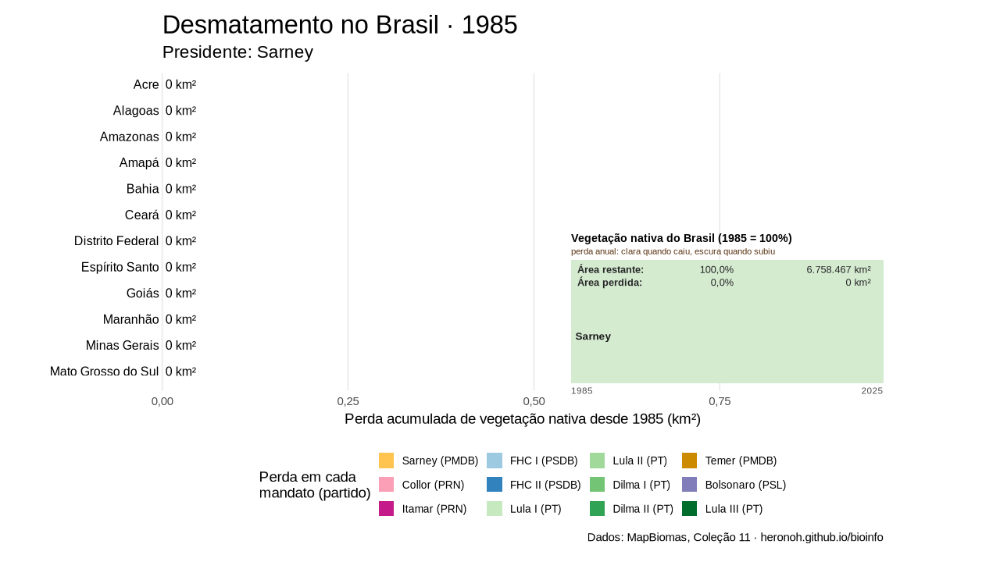
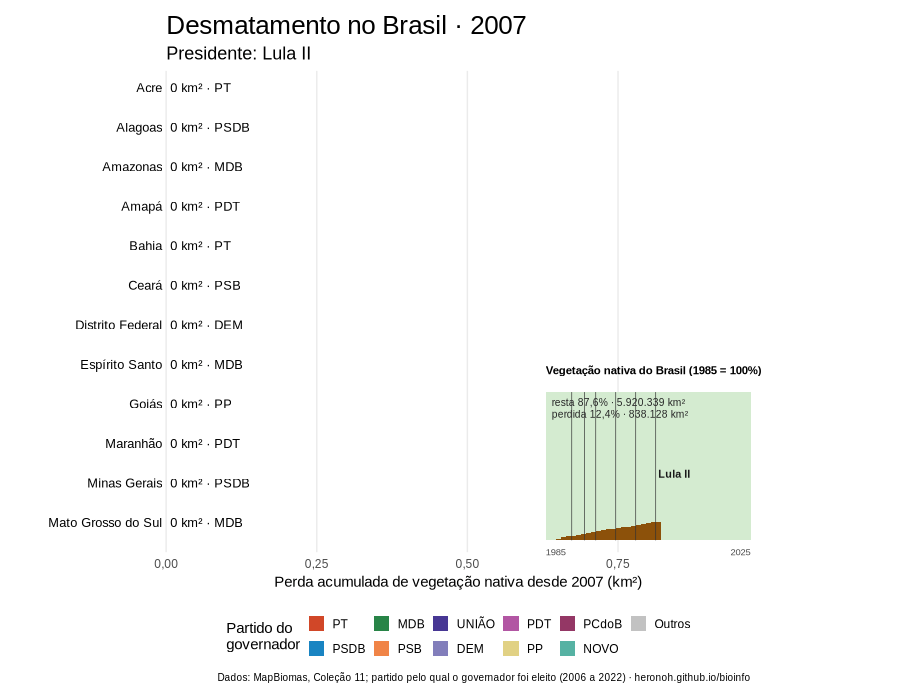
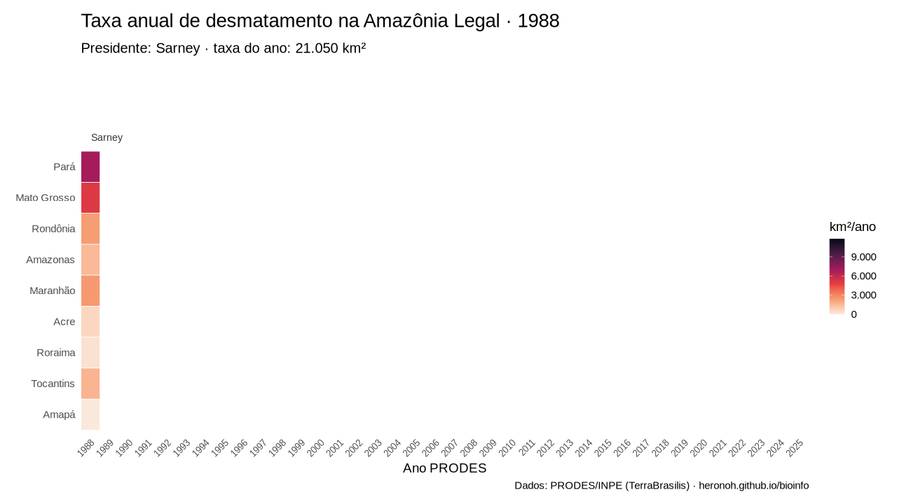

```{r}
#| include: false
# Define locale para meses/datas em português
try({ Sys.setlocale('LC_TIME', 'pt_BR.UTF-8') }, silent = TRUE)
try({ Sys.setlocale('LC_TIME', 'Portuguese_Brazil.1252') }, silent = TRUE)
```

```{r setup, include=FALSE}
knitr::opts_chunk$set(echo = TRUE, fig.width = 9, fig.height = 5.5, out.width = "100%")

library("ggplot2")
library("dplyr")

# arquivos locais, usados apenas para renderizar o site
desmat <- read.csv(file = "aulas/r/arquivos/desmatamento_prodes_amazonia_uf.csv",
                   sep = ",", fileEncoding = "UTF-8") %>% tibble::tibble()

veg <- read.csv(file = "aulas/r/arquivos/vegetacao_nativa_mapbiomas_uf.csv",
                sep = ",", fileEncoding = "UTF-8") %>% tibble::tibble()

num <- scales::label_number(big.mark = ".", decimal.mark = ",")
```

```{r color, echo=FALSE, results='asis'}
#configurar pros **R**esultados do bash sairem coloridos e não ANSI

old_hooks <- fansi::set_knit_hooks(
  knitr::knit_hooks,
  which = c("output", "message", "error")
)
```

     Olá, esta é mais uma de um conjunto de práticas em bioinformática desenvolvidas para o curso de Biomedicina da *PUC-MG*. Você pode encontrar as demais práticas [*aqui*](https://heronoh.github.io/bioinfo/aulas).

     Hoje nós vamos trabalhar com dados públicos sobre o *desmatamento* no Brasil, produzidos a partir de imagens de satélite.

# Introdução

## Por que estudar desmatamento?

     O Brasil abriga seis biomas continentais: *Amazônia*, *Cerrado*, *Mata Atlântica*, *Caatinga*, *Pampa* e *Pantanal*. A perda de vegetação nativa afeta diretamente a biodiversidade, o regime de chuvas, a emissão de gases de efeito estufa e também a saúde humana, por exemplo ao aproximar pessoas de reservatórios de patógenos e vetores de doenças.

     O Brasil é um dos países com o monitoramento por satélite mais longo e consolidado do mundo, e a maior parte desses dados é aberta. Isso faz deles um ótimo material para praticar análise de dados tabulares no R.

## Onde obter os dados

Existem diversas fontes, que diferem quanto ao **método**, à **escala** e ao **período coberto**. Por isso é comum que os números de uma fonte não batam exatamente com os de outra. Vamos conhecer as principais:

### INPE - PRODES e DETER (portal TerraBrasilis)

-   **Instituição:** [Instituto Nacional de Pesquisas Espaciais (INPE)](https://www.gov.br/inpe), órgão federal ligado ao Ministério da Ciência, Tecnologia e Inovação.
-   **PRODES** (*Projeto de Monitoramento do Desmatamento na Amazônia Legal por Satélite*): calcula a **taxa anual de desmatamento** por corte raso, a partir de imagens da série Landsat e similares. Na Amazônia Legal a série começa em **1988**, e hoje o projeto cobre todos os biomas.
-   **DETER** (*Detecção de Desmatamento em Tempo Real*): sistema de **alertas** quase diários, criado para orientar a fiscalização. Não serve para calcular taxas oficiais, mas mostra a dinâmica ao longo do ano.
-   **Onde baixar:** portal [*TerraBrasilis*](https://terrabrasilis.dpi.inpe.br/), na [página de downloads](https://terrabrasilis.dpi.inpe.br/downloads/), com arquivos em formato `.csv`, shapefile e raster. Os painéis de taxas do próprio portal também permitem exportar tabelas.

> O "ano PRODES" não é o ano civil: ele vai de agosto de um ano a julho do ano seguinte, que é a época seca na Amazônia, com menos nuvens nas imagens.

### MapBiomas

-   **Instituição:** [*MapBiomas*](https://brasil.mapbiomas.org/), rede colaborativa de universidades, ONGs e empresas de tecnologia.
-   **O que oferece:** mapas anuais de **cobertura e uso da terra** de todo o Brasil desde **1985**, com resolução de 30 m, classificando cada pixel em classes como *Formação Florestal*, *Formação Savânica*, *Pastagem*, *Agricultura*, *Área Urbana* etc. Também tem módulos de desmatamento, vegetação secundária, fogo, mineração e superfície de água.
-   **Onde baixar:** a página de [*estatísticas*](https://brasil.mapbiomas.org/estatisticas/) disponibiliza planilhas com a **área (em hectares) de cada classe** por bioma, estado e município, para cada ano. É a fonte mais prática para obter a **área absoluta de vegetação nativa** por estado.

### IBGE

-   **Instituição:** [Instituto Brasileiro de Geografia e Estatística (IBGE)](https://www.ibge.gov.br/).
-   **O que oferece:** os **limites oficiais dos biomas**, dos estados e dos municípios, além do *Monitoramento da Cobertura e Uso da Terra do Brasil*. Os códigos de município do IBGE (7 dígitos) são a "chave" que permite cruzar dados ambientais com dados de saúde, como os do *SUS*.

### SOS Mata Atlântica

-   **Instituição:** [Fundação SOS Mata Atlântica](https://www.sosma.org.br/), em parceria com o INPE.
-   **O que oferece:** o *Atlas dos Remanescentes Florestais da Mata Atlântica*, que acompanha desde o fim dos anos 1980 o que resta de floresta no bioma mais desmatado do país.

### Outras fontes úteis

-   [**Global Forest Watch**](https://www.globalforestwatch.org/): perda anual de cobertura arbórea em escala global, a partir de 2001, com recortes por país e estado.
-   [**Base dos Dados**](https://basedosdados.org/): reúne em um só lugar diversos conjuntos públicos brasileiros já tratados, acessíveis pelo pacote de R `basedosdados` (exige um projeto no Google Cloud).

# Prática

[<i class="bi bi-download"></i> Baixar o script desta prática (.R)](scripts/desmatamento.R){.btn .btn-outline-primary download="desmatamento.R"}

     Nesta prática vamos reconstruir, passo a passo, a história do desmatamento na **Amazônia Legal** desde o início do monitoramento, em 1988. A Amazônia Legal é uma região político-administrativa formada por nove estados: Acre, Amapá, Amazonas, Mato Grosso, Pará, Rondônia, Roraima, Tocantins e parte do Maranhão.

     Vamos usar dois conjuntos de dados:

-   as **taxas anuais consolidadas do PRODES** por estado, exportadas do painel do TerraBrasilis, que medem o que **foi desmatado** na Amazônia Legal a cada ano, desde 1988;
-   a **área de vegetação nativa** de cada estado em cada bioma, de 1985 a 2025, da **Coleção 11 do MapBiomas**, que mede o que **ainda existe** em todos os biomas.

Com eles, vamos responder a quatro perguntas:

1.  Como o desmatamento variou ao longo de quase quatro décadas?
2.  Quais estados concentram o desmatamento, e isso mudou com o tempo?
3.  Quanto de floresta já foi perdido, somando todos os anos?
4.  Quanto resta de vegetação nativa em cada bioma e em cada estado?

## Preparação

### Carregar pacotes

``` r
# para instalar os pacotes, caso ainda não tenha (só se instala uma vez)
install.packages("ggplot2")
install.packages("dplyr")

# execute para carregar os pacotes
library("ggplot2")
library("dplyr")

# função para escrever números no padrão brasileiro (1.234,5)
num <- scales::label_number(big.mark = ".", decimal.mark = ",")
```

> DICA: toda vez que você reiniciar uma sessão é necessário carregar os pacotes novamente. Eles são a primeira coisa de qualquer código.

## Obtendo os dados

### Definindo seu diretório de trabalho

Para cada projeto, sempre crie uma pasta onde você vai salvar todos arquivos e scripts, assim você mantém seu trabalho sempre organizado. No comando abaixo, coloque dentro das aspas o caminho para o seu diretório de trabalho.

> DICA: Sempre utilize a tecla `TAB` para autocompletar os caminhos a partir do **\~** ou **/** (ou \*\*\*\*, caso no windows). Para isso, coloque o cursor (\|, a barra onde sua digitação aparece) entre as " ".

``` r
getwd()

setwd("")
# utilize o tab para autocompletar com o cursor entre as aspas
```

### Obter arquivos

Para facilitar, iremos trabalhar com dois arquivos já organizados, que devem ser baixados com os comandos a seguir. Você irá fazer download dos arquivos e em seguida iremos carregá-los no R.

``` r
# taxas anuais de desmatamento na Amazônia Legal (PRODES/INPE)
download.file(
  "https://raw.githubusercontent.com/heronoh/bioinfo/main/aulas/r/arquivos/desmatamento_prodes_amazonia_uf.csv",
  destfile = "desmatamento_prodes_amazonia_uf.csv",
  mode = "wb",
  method = "libcurl"
  )

# área de vegetação nativa por bioma e estado (MapBiomas, Coleção 11)
download.file(
  "https://raw.githubusercontent.com/heronoh/bioinfo/main/aulas/r/arquivos/vegetacao_nativa_mapbiomas_uf.csv",
  destfile = "vegetacao_nativa_mapbiomas_uf.csv",
  mode = "wb",
  method = "libcurl"
  )
```

> DICA 1: Para prosseguir na análise que vamos desenvolver, copie e cole os blocos de código num novo documento do tipo *.R*.

> DICA 2: utilize a tecla **tab** para autocompletar e evitar erros!

### Ler os arquivos `.csv`

   O formato `.csv` (*comma-separated values*) é um arquivo de texto simples em que cada linha é uma observação e as colunas são separadas por vírgulas. Você pode abri-lo em qualquer editor de texto para ver como ele é por dentro. No R, ele é lido com a função `read.csv()`:

``` r
#complete usando a tecla TAB até chegar aos arquivos que você baixou
desmat <- read.csv(file = "desmatamento_prodes_amazonia_uf.csv",
                   sep = ",",
                   fileEncoding = "UTF-8"
                   ) %>%
  tibble::tibble()

veg <- read.csv(file = "vegetacao_nativa_mapbiomas_uf.csv",
                sep = ",",
                fileEncoding = "UTF-8"
                ) %>%
  tibble::tibble()
```

::: {style="background:#FFF7CC; border-left:6px solid #F0B400; padding:1rem 1.25rem; border-radius:8px; margin:1rem 0;"}
### Para outros projetos

O arquivo desta prática é um recorte já organizado. Para outras perguntas, você pode baixar diretamente das fontes:

-   **PRODES de outros biomas (Cerrado, Mata Atlântica, Caatinga, Pampa, Pantanal), por município ou como polígonos:** [TerraBrasilis - downloads](https://terrabrasilis.dpi.inpe.br/downloads/)
-   **Área de cada classe de cobertura e uso da terra, por estado, município, terra indígena ou unidade de conservação:** [MapBiomas - estatísticas](https://brasil.mapbiomas.org/estatisticas/)

As tabelas exportadas por essas plataformas costumam vir no formato *largo* (um ano por coluna) e com números no padrão brasileiro (vírgula decimal). Nesses casos, use `read.csv2()` no lugar de `read.csv()`, e converta para o formato *longo* com `tidyr::pivot_longer()`:

``` {.r .nao-script}
install.packages("tidyr")
library(tidyr)

# exemplo: transformar colunas "1985", "1986", ... em uma coluna "ano"
tabela_longa <- tabela_larga %>%
  pivot_longer(cols = matches("^[0-9]{4}$"),
               names_to = "ano",
               values_to = "area_ha") %>%
  mutate(ano = as.numeric(ano))
```
:::

## Conhecendo a tabela

   Antes de qualquer gráfico, precisamos saber **o que é cada linha** da tabela. Aqui, cada linha é a combinação de um **ano** e um **estado**, e a coluna `desmatamento_km2` traz a área desmatada naquele estado, naquele ano.

```{r conhecer, echo=TRUE}
# as primeiras linhas
head(desmat)

# estrutura: nome, tipo e exemplos de cada coluna
str(desmat)

# quantas linhas e colunas?
dim(desmat)
```

```{r conhecer2, echo=TRUE}
# quais estados?
unique(desmat$estado)

# qual o período coberto?
range(desmat$ano)

# quantas linhas por estado? (deve ser igual ao número de anos)
table(desmat$uf)

# resumo da coluna numérica
summary(desmat$desmatamento_km2)
```

> PERGUNTA: Se a série vai de 1988 a 2025 e são 9 estados, quantas linhas a tabela deveria ter? Confira com `nrow(desmat)`.

::: callout-note
## Duas particularidades da série histórica

-   O valor de **1988** é uma **média anual** do período de 1977 a 1988, e não a medição de um único ano.
-   Os valores de **1993** e **1994** são iguais porque correspondem à média dos dois anos, que foram mapeados em conjunto.

Saber como o dado foi produzido é parte essencial de qualquer análise!
:::

## Contexto: os mandatos presidenciais

   O desmatamento responde a políticas públicas, como fiscalização, crédito rural e criação de áreas protegidas, que mudam de um governo para outro. Para ajudar a interpretar os gráficos, vamos marcar neles os mandatos presidenciais do período.

   Em vez de baixar outro arquivo, vamos **criar a tabela diretamente no R** com a função `tribble()`, que permite escrever uma tabela linha por linha, de forma bem legível:

```{r mandatos, echo=TRUE}
mandatos <- tibble::tribble(
  ~presidente,                 ~rotulo,     ~inicio,      ~fim,
  "José Sarney",               "Sarney",    "1985-03-15", "1990-03-15",
  "Fernando Collor",           "Collor",    "1990-03-15", "1992-10-02",
  "Itamar Franco",             "Itamar",    "1992-10-02", "1995-01-01", # interino até a renúncia de Collor, em 29/12/1992
  "Fernando Henrique Cardoso", "FHC I",     "1995-01-01", "1999-01-01",
  "Fernando Henrique Cardoso", "FHC II",    "1999-01-01", "2003-01-01",
  "Luiz Inácio Lula da Silva", "Lula I",    "2003-01-01", "2007-01-01",
  "Luiz Inácio Lula da Silva", "Lula II",   "2007-01-01", "2011-01-01",
  "Dilma Rousseff",            "Dilma I",   "2011-01-01", "2015-01-01",
  "Dilma Rousseff",            "Dilma II",  "2015-01-01", "2016-05-12", # até o impeachment (golpe) em 31 de agosto de 2016
  "Michel Temer",              "Temer",     "2016-05-12", "2019-01-01", # interino até 31/08/2016
  "Jair Bolsonaro",            "Bolsonaro", "2019-01-01", "2023-01-01",
  "Luiz Inácio Lula da Silva", "Lula III",  "2023-01-01", "2027-01-05"
)

mandatos
```

   Nossos gráficos usam o **ano** como eixo, então precisamos converter as datas em "anos decimais" (por exemplo, 1° de julho de 2016 ≈ 2016,5):

```{r mandatos_ano, echo=TRUE}
# converte uma data em ano decimal
ano_decimal <- function(data) {
  data <- as.Date(data)
  as.numeric(format(data, "%Y")) + (as.numeric(format(data, "%j")) - 1) / 365
}

mandatos <- mandatos %>%
  mutate(inicio_ano = ano_decimal(inicio),
         fim_ano    = ano_decimal(fim),
         cor_faixa  = ifelse(row_number() %% 2 == 0, "grey80", "grey93"))

mandatos %>% select(rotulo, inicio_ano, fim_ano)
```

   Vamos marcar também o período da **pandemia de COVID-19**, em vermelho escuro. Ele começa em 11/03/2020, quando a OMS caracterizou a COVID-19 como pandemia e o Distrito Federal adotou as primeiras medidas de restrição de circulação. Termina em 22/05/2022, com o fim da Emergência em Saúde Pública de Importância Nacional (Portaria GM/MS nº 913, em vigor 30 dias após sua publicação, em 22/04/2022). O Brasil não teve um *lockdown* nacional: as quarentenas foram decretadas por estados e municípios, a partir de março de 2020, com intensidade e duração diferentes em cada lugar.

```{r pandemia, echo=TRUE}
cor_pandemia <- "#8B0000"   # vermelho escuro

pandemia <- tibble::tribble(
  ~evento,                ~rotulo,    ~inicio,      ~fim,
  "Pandemia de COVID-19", "COVID-19", "2020-03-11", "2022-05-22"
) %>%
  mutate(inicio_ano = ano_decimal(inicio),
         fim_ano    = ano_decimal(fim))

pandemia
```

   Como vamos repetir essas marcações em vários gráficos, criamos **funções** que devolvem camadas prontas do `ggplot2`. Assim, basta "somar" `+ mandatos_fundo()` ou `+ mandatos_linhas()` a qualquer gráfico. Os argumentos `de` e `ate` indicam o período do gráfico, para cortar os mandatos que começam antes ou terminam depois da série:

```{r mandatos_funcoes, echo=TRUE}
# recorta os mandatos ao período do gráfico
mandatos_periodo <- function(de, ate) {
  mandatos %>%
    mutate(inicio_ano = pmax(inicio_ano, de - 0.5),
           fim_ano    = pmin(fim_ano,    ate + 0.5),
           meio       = (inicio_ano + fim_ano) / 2) %>%   # posição do nome
    filter(inicio_ano < fim_ano)
}

# o mesmo para o período da pandemia
pandemia_periodo <- function(de, ate) {
  pandemia %>%
    mutate(inicio_ano = pmax(inicio_ano, de - 0.5),
           fim_ano    = pmin(fim_ano,    ate + 0.5),
           meio       = (inicio_ano + fim_ano) / 2) %>%
    filter(inicio_ano < fim_ano)
}

# faixas de fundo, alternando tons de cinza, e a pandemia em vermelho
# (adicionar ANTES dos dados)
mandatos_fundo <- function(de = 1988, ate = 2025) {
  m <- mandatos_periodo(de, ate)
  # uma camada para cada tom de cinza
  faixas <- lapply(c("grey80", "grey93"), function(cor) {
    geom_rect(data = m %>% filter(cor_faixa == cor),
              aes(xmin = inicio_ano, xmax = fim_ano, ymin = -Inf, ymax = Inf),
              fill = cor,
              alpha = 0.6,
              inherit.aes = FALSE)
  })
  covid <- geom_rect(data = pandemia_periodo(de, ate),
                     aes(xmin = inicio_ano, xmax = fim_ano, ymin = -Inf, ymax = Inf),
                     fill = cor_pandemia,
                     alpha = 0.18,
                     inherit.aes = FALSE)
  c(faixas, list(covid))
}

# linhas de troca de mandato + nomes dos presidentes (adicionar NO FINAL)
# dentro = FALSE: nomes acima do gráfico; dentro = TRUE: nomes verticais dentro de cada painel
# so_no_painel: em gráficos com painéis, escreve os nomes só em um deles,
#               por exemplo so_no_painel = list(bioma = "Amazônia")
mandatos_linhas <- function(de = 1988, ate = 2025, dentro = FALSE, tamanho = 3,
                            so_no_painel = NULL) {
  m <- mandatos_periodo(de, ate)
  m_nomes <- m
  for (coluna in names(so_no_painel)) m_nomes[[coluna]] <- so_no_painel[[coluna]]
  linhas <- geom_vline(data = m %>% filter(inicio_ano > de - 0.5),
                       aes(xintercept = inicio_ano),
                       linetype = "dashed", linewidth = 0.3, colour = "grey20",
                       inherit.aes = FALSE)
  # pandemia: linha cheia no início e pontilhada no fim, em vermelho escuro
  p <- pandemia_periodo(de, ate)
  p_nomes <- p
  for (coluna in names(so_no_painel)) p_nomes[[coluna]] <- so_no_painel[[coluna]]
  linhas_covid <- list(
    geom_vline(data = p, aes(xintercept = inicio_ano),
               linewidth = 0.7, colour = cor_pandemia, inherit.aes = FALSE),
    geom_vline(data = p, aes(xintercept = fim_ano),
               linetype = "dotted", linewidth = 0.7, colour = cor_pandemia,
               inherit.aes = FALSE))
  if (dentro) {
    nomes <- geom_text(data = m_nomes,
                       aes(x = meio, y = Inf, label = rotulo),
                       angle = 90, hjust = 1.1, size = tamanho, colour = "grey20",
                       inherit.aes = FALSE)
    # nos painéis, a pandemia é marcada só pela faixa e pelas linhas vermelhas
    c(list(linhas, nomes), linhas_covid)
  } else {
    # nomes em duas alturas alternadas, para não se sobreporem nos mandatos curtos
    m_nomes$altura <- ifelse(seq_len(nrow(m_nomes)) %% 2 == 1, -0.5, -1.9)
    nomes <- geom_text(data = m_nomes,
                       aes(x = meio, y = Inf, label = rotulo, vjust = altura),
                       size = tamanho, colour = "grey20",
                       inherit.aes = FALSE)
    # "COVID-19" numa terceira linha, acima dos presidentes
    nome_covid <- geom_text(data = p_nomes,
                            aes(x = meio, y = Inf, label = rotulo),
                            vjust = -3.3, size = tamanho, fontface = "bold",
                            colour = cor_pandemia, inherit.aes = FALSE)
    c(list(linhas, nomes), linhas_covid,
      list(nome_covid,
           coord_cartesian(clip = "off"),  # permite escrever fora da área do gráfico
           theme(plot.title = element_text(margin = margin(b = 44)),
                 plot.margin = margin(t = 48, r = 6, b = 6, l = 6))))
  }
}
```

> ATENÇÃO: o "ano PRODES" vai de agosto a julho, então as trocas de mandato e o período da pandemia aparecem no meio de uma barra ou de um ano. As marcações servem para orientar a leitura, não como fronteiras exatas.

## A série histórica da Amazônia Legal

   Para obter o total da Amazônia Legal em cada ano, somamos os nove estados com a dupla `group_by()` + `summarise()`:

```{r total_ano, echo=TRUE}
total_ano <- desmat %>%
  group_by(ano) %>%
  summarise(desmatamento_km2 = sum(desmatamento_km2))

total_ano
```

   Quais foram os anos de maior e de menor desmatamento?

```{r extremos, echo=TRUE}
total_ano %>% slice_max(desmatamento_km2, n = 3)
total_ano %>% slice_min(desmatamento_km2, n = 3)
```

```{r grafico_total, echo=TRUE}
total_ano %>%
  ggplot(aes(x = ano, y = desmatamento_km2, fill = desmatamento_km2)) +
  mandatos_fundo() +
  geom_col() +
  scale_fill_viridis_c(option = "rocket", direction = -1, guide = "none") +
  scale_y_continuous(labels = num,
                     limits = c(0,30000),
                     expand = F) +
  scale_x_continuous(breaks = seq(1988, 2025, by = 1)) +
  labs(title = "Taxa anual de desmatamento na Amazônia Legal (PRODES)",
       x = "Ano PRODES",
       y = "Desmatamento (km²/ano)") +
  theme_minimal() +
  theme(axis.text.x = element_text(angle = 45,hjust = 1)) +
  mandatos_linhas()
```

> PERGUNTA: O gráfico mostra dois grandes picos e uma queda acentuada entre 2004 e 2012. Pesquise que políticas públicas foram adotadas nesse período. O que aconteceu depois de 2012?

## Comparando os estados

### Um gráfico para cada estado

   Com `facet_wrap()` desenhamos um painel por estado, todos na mesma escala, o que facilita a comparação:

```{r grafico_facetas, echo=TRUE, fig.height=7}
desmat %>%
  ggplot(aes(x = ano, y = desmatamento_km2)) +
  mandatos_fundo() +
  geom_area(fill = "#B5442E", alpha = 0.8) +
  facet_wrap(~ estado) +
  scale_y_continuous(labels = num) +
  labs(x = "Ano PRODES",
       y = "Desmatamento (km²/ano)") +
  theme_minimal() +
  mandatos_linhas(dentro = TRUE, tamanho = 2.2)
```

### Mapa de calor

   Outra forma de enxergar a tabela inteira de uma só vez é um **mapa de calor** (*heatmap*), em que cada célula é um par estado-ano, e a cor indica a área desmatada. Usamos `reorder()` para ordenar os estados pelo total desmatado:

```{r grafico_heatmap, echo=TRUE, fig.height=4.5}
desmat %>%
  ggplot(aes(x = ano,
             y = reorder(estado, desmatamento_km2, FUN = sum),
             fill = desmatamento_km2)) +
  geom_tile(color = "white") +
  scale_fill_viridis_c(option = "rocket", direction = -1, labels = num) +
  scale_x_continuous(breaks = seq(1988, 2025, by = 1), expand = c(0, 0)) +
  labs(x = "Ano PRODES",
       y = NULL,
       fill = "km²/ano") +
  theme_minimal() +
  theme(axis.text.x = element_text(angle = 45, hjust = 1)) +
  mandatos_linhas()
```

### Participação de cada estado

   Com `position = "fill"`, cada barra passa a somar 100%, e vemos a **proporção** de cada estado no desmatamento de cada ano:

```{r grafico_proporcao, echo=TRUE}
desmat %>%
  ggplot(aes(x = ano,
             y = desmatamento_km2,
             fill = reorder(estado, desmatamento_km2, FUN = sum))) +
  geom_col(position = "fill", width = 1) +
  scale_fill_viridis_d(option = "turbo") +
  scale_y_continuous(labels = scales::label_percent(), expand = c(0, 0)) +
  scale_x_continuous(breaks = seq(1988, 2025, by = 1), expand = c(0, 0)) +
  labs(x = "Ano PRODES",
       y = "Participação no desmatamento do ano",
       fill = "Estado") +
  theme_minimal() +
  theme(axis.text.x = element_text(angle = 45, hjust = 1)) +
  mandatos_linhas()
```

> PERGUNTA: Qual estado liderava o desmatamento no início da série? E nos anos mais recentes?

## Desmatamento acumulado

   A taxa anual mostra quanto foi desmatado **em cada ano**. Mas a floresta perdida em um ano não volta no ano seguinte: as perdas se **somam**. Para medir o impacto total, calculamos o **desmatamento acumulado** com a função `cumsum()` (*cumulative sum*, soma acumulada):

```{r cumsum_exemplo, echo=TRUE}
# como funciona a soma acumulada?
c(10, 20, 5, 15)
cumsum(c(10, 20, 5, 15))
```

   Para acumular **separadamente para cada estado**, ordenamos por ano, agrupamos por estado e só então usamos o `cumsum()`:

```{r acumulado, echo=TRUE}
desmat_acum <- desmat %>%
  arrange(estado, ano) %>%
  group_by(estado) %>%
  mutate(acumulado_km2 = cumsum(desmatamento_km2)) %>%
  ungroup()

# conferindo um estado
desmat_acum %>% filter(uf == "MT")
```

### Desmatamento acumulado, ano a ano

   Agora vamos ver o desmatamento acumulado de toda a Amazônia Legal como um gráfico de barras, uma barra por ano. A cor de cada barra conta o que aconteceu com a **taxa anual** em relação ao ano anterior: **marrom claro** quando a taxa caiu (ou se manteve) e **marrom escuro** quando subiu. A intensidade da cor é proporcional à taxa daquele ano: quanto mais forte, mais se desmatou naquele ano.

   Para comparar cada ano com o anterior, usamos a função `lag()`, que pega o valor da linha de cima:

```{r acumulado_ano, echo=TRUE}
acumulado_ano <- total_ano %>%
  arrange(ano) %>%
  mutate(acumulado_km2 = cumsum(desmatamento_km2),
         variacao = case_when(
           is.na(lag(desmatamento_km2))             ~ "1988 (média de 1977 a 1988)",
           desmatamento_km2 > lag(desmatamento_km2) ~ "Taxa subiu",
           TRUE                                     ~ "Taxa caiu ou se manteve"))

acumulado_ano
```

```{r grafico_acumulado, echo=TRUE, fig.height=6}
acumulado_ano %>%
  ggplot(aes(x = ano, y = acumulado_km2,
             fill = variacao, alpha = desmatamento_km2)) +
  mandatos_fundo() +
  geom_col(width = 0.85) +
  scale_fill_manual(values = c("Taxa caiu ou se manteve"     = "#c8a165",
                               "Taxa subiu"                  = "#5b3412",
                               "1988 (média de 1977 a 1988)" = "grey60")) +
  scale_alpha_continuous(range = c(0.35, 1), labels = num) +
  scale_y_continuous(labels = num, expand = c(0, 0)) +
  scale_x_continuous(breaks = seq(1988, 2025, by = 1), expand = c(0, 0)) +
  labs(title = "Desmatamento acumulado na Amazônia Legal desde 1988",
       x = "Ano PRODES",
       y = "Área desmatada acumulada (km²)",
       fill = "Em relação ao\nano anterior",
       alpha = "Taxa anual\n(km²/ano)") +
  theme_minimal() +
  theme(axis.text.x = element_text(angle = 45, hjust = 1)) +
  mandatos_linhas()
```

> PERGUNTA: Em quais mandatos predominam as barras escuras (taxa subindo)? E as claras?

### Quanto cada estado já perdeu?

   Por fim, pegamos o valor acumulado do último ano de cada estado e colocamos em ordem:

```{r ranking, echo=TRUE}
ranking <- desmat_acum %>%
  filter(ano == max(ano)) %>%
  arrange(desc(acumulado_km2))

ranking %>% select(estado, acumulado_km2)

# total da Amazônia Legal
sum(ranking$acumulado_km2) %>% num()
```

```{r grafico_ranking, echo=TRUE, fig.height=4.5}
ranking %>%
  ggplot(aes(x = acumulado_km2,
             y = reorder(estado, acumulado_km2))) +
  geom_col(fill = "#B5442E") +
  geom_text(aes(label = num(acumulado_km2)), hjust = -0.1, size = 3.5) +
  scale_x_continuous(labels = num, expand = expansion(mult = c(0, 0.15))) +
  labs(x = "Desmatamento acumulado desde 1988 (km²)",
       y = NULL) +
  theme_minimal()
```

> PERGUNTA: A área total desmatada desde 1988 equivale a quanto do território de Minas Gerais (cerca de 586 mil km²)?

## Vegetação nativa em todos os biomas (MapBiomas)

   Os dados do PRODES contam o que **foi perdido**, e só na Amazônia Legal. Agora vamos olhar o outro lado: quanto **ainda existe** de vegetação nativa em **todos os biomas**, segundo a Coleção 11 do MapBiomas.

### Conhecendo a tabela

   Aqui, cada linha é a combinação de um **bioma**, um **estado** e um **ano**. Um mesmo estado pode aparecer em mais de um bioma: Minas Gerais, por exemplo, tem partes na Mata Atlântica, no Cerrado e na Caatinga. As áreas estão em **hectares** (1 km² = 100 ha):

-   `floresta_ha`: formações florestais, savânicas, mangues e florestas alagáveis;
-   `campestre_ha`: vegetação herbácea e arbustiva natural (campos, áreas úmidas, afloramentos rochosos etc.);
-   `vegetacao_nativa_ha`: a soma das duas;
-   `area_total_ha`: a área total daquele estado dentro daquele bioma.

```{r veg_conhecer, echo=TRUE}
head(veg)

# período coberto
range(veg$ano)

# quantos estados em cada bioma?
veg %>%
  distinct(bioma, uf) %>%
  count(bioma)
```

> PERGUNTA: Por que a Amazônia tem 9 estados nesta tabela, mas Minas Gerais aparece em três biomas diferentes?

### Quanto resta em cada bioma?

   Somando todos os estados, temos a vegetação nativa de cada bioma, ano a ano. Note que agora o período começa em **1985**, por isso passamos `de = 1985` para as funções dos mandatos:

```{r veg_bioma, echo=TRUE}
veg_bioma <- veg %>%
  group_by(bioma, ano) %>%
  summarise(vegetacao_nativa_ha = sum(vegetacao_nativa_ha),
            area_total_ha       = sum(area_total_ha)) %>%
  ungroup() %>%
  mutate(perc_nativa = 100 * vegetacao_nativa_ha / area_total_ha)

veg_bioma %>% filter(ano %in% c(1985, 2025))
```

```{r grafico_veg_bioma, echo=TRUE}
cores_biomas <- c("Amazônia" = "#1f6f43", "Cerrado" = "#c9a227",
                  "Mata Atlântica" = "#5fa35f", "Caatinga" = "#d9805f",
                  "Pampa" = "#9ec46b", "Pantanal" = "#3f8fb5")

veg_bioma %>%
  ggplot(aes(x = ano,
             y = vegetacao_nativa_ha / 1e6,
             fill = bioma,
             col = bioma)) +
  mandatos_fundo(de = 1985) +
  geom_density(stat = "identity", position = "stack", alpha = 0.85) +
  scale_fill_manual(values = cores_biomas) +
  scale_color_manual(values = cores_biomas) +
  scale_x_continuous(breaks = seq(1985, 2025, by = 1), expand = c(0, 0)) +
  scale_y_continuous(expand = c(0, 0)) +
  labs(title = "Vegetação nativa no Brasil, por bioma (MapBiomas)",
       x = "Ano",
       y = "Vegetação nativa (milhões de ha)",
       fill = "Bioma",
       col = "Bioma") +
  theme_minimal() +
  theme(axis.text.x = element_text(angle = 45, hjust = 1)) +
  mandatos_linhas(de = 1985)
```

   Em valores absolutos, a Amazônia domina o gráfico. Para comparar biomas de tamanhos tão diferentes, olhamos a **porcentagem** do bioma ainda coberta por vegetação nativa:

```{r grafico_veg_perc, echo=TRUE}
veg_bioma %>%
  ggplot(aes(x = ano, y = perc_nativa, col = bioma)) +
  mandatos_fundo(de = 1985) +
  geom_line(linewidth = 1.2) +
  scale_color_manual(values = cores_biomas) +
  scale_x_continuous(breaks = seq(1985, 2025, by = 1), expand = c(0, 0)) +
  scale_y_continuous(limits = c(0, 100), expand = c(0, 0)) +
  labs(x = "Ano",
       y = "Área do bioma com vegetação nativa (%)",
       col = "Bioma") +
  theme_minimal() +
  theme(axis.text.x = element_text(angle = 45, hjust = 1)) +
  mandatos_linhas(de = 1985)
```

> PERGUNTA: Qual bioma perdeu proporcionalmente mais vegetação nativa desde 1985? E qual já tinha a menor cobertura nativa no início da série? O que isso indica sobre a história de ocupação do país?

### Variação acumulada por estado

   Agora vamos calcular, para cada estado dentro de cada bioma, quanto de vegetação nativa foi perdido **em relação a 1985**. A função `first()` pega o primeiro valor de cada grupo, que é o de 1985, já que ordenamos por ano:

```{r veg_variacao, echo=TRUE}
veg_var <- veg %>%
  arrange(bioma, uf, ano) %>%
  group_by(bioma, uf) %>%
  mutate(perda_acumulada_ha = first(vegetacao_nativa_ha) - vegetacao_nativa_ha,
         perc_restante      = 100 * vegetacao_nativa_ha / first(vegetacao_nativa_ha)) %>%
  ungroup()

# os 10 recortes com maior perda acumulada até 2025
veg_var %>%
  filter(ano == max(ano)) %>%
  slice_max(perda_acumulada_ha, n = 10) %>%
  select(bioma, estado, perda_acumulada_ha, perc_restante)
```

#### Gráfico de densidade da perda acumulada por estado

   Empilhando os estados, a altura total em cada ano é a perda acumulada do bioma desde 1985, e cada faixa mostra a contribuição de um estado:

```{r grafico_veg_densidade, echo=TRUE, fig.height=8}
veg_var %>%
  ggplot(aes(x = ano,
             y = perda_acumulada_ha / 1e6,
             fill = uf,
             col = uf)) +
  mandatos_fundo(de = 1985) +
  geom_density(stat = "identity", position = "stack", alpha = 0.85) +
  facet_wrap(~ bioma, scales = "free_y", ncol = 2) +
  scale_fill_viridis_d(option = "turbo") +
  scale_color_viridis_d(option = "turbo") +
  scale_x_continuous(breaks = seq(1985, 2025, by = 10), expand = c(0, 0)) +
  labs(x = "Ano",
       y = "Perda acumulada desde 1985 (milhões de ha)",
       fill = "UF",
       col = "UF") +
  guides(fill = guide_legend(ncol = 2), col = guide_legend(ncol = 2)) +
  theme_minimal() +
  mandatos_linhas(de = 1985, dentro = TRUE, tamanho = 2.2)
```

> ATENÇÃO: no Pantanal, e em alguns estados da Mata Atlântica, a perda acumulada fica **negativa**, ou seja, há mais vegetação nativa hoje do que em 1985. Isso não é um erro! Na Mata Atlântica, reflete a regeneração de florestas. No Pantanal, os anos mais secos transformam áreas de água em campos alagáveis, que contam como vegetação nativa. Interpretar o dado exige conhecer o bioma.

#### Mapa de calor: quanto resta em cada estado

   Por fim, um mapa de calor com a porcentagem da vegetação nativa de 1985 que ainda existia em cada ano. Com `facet_grid()` e `space = "free_y"`, cada bioma ganha uma altura proporcional ao seu número de estados:

```{r grafico_veg_heatmap, echo=TRUE, fig.height=9}
veg_var %>%
  ggplot(aes(x = ano,
             y = reorder(estado, perc_restante, FUN = min),
             fill = perc_restante)) +
  geom_tile() +
  facet_grid(bioma ~ ., scales = "free_y", space = "free_y") +
  scale_fill_distiller(palette = "RdYlGn", direction = 1, limits = c(50, 115),
                       oob = scales::squish) +
  scale_x_continuous(breaks = seq(1985, 2025, by = 1), expand = c(0, 0)) +
  labs(x = "Ano",
       y = NULL,
       fill = "% da vegetação\nnativa de 1985") +
  theme_minimal() +
  theme(strip.text.y = element_text(angle = 0, hjust = 0),
        axis.text.x = element_text(angle = 45, hjust = 1)) +
  mandatos_linhas(de = 1985, tamanho = 2.5,
                  so_no_painel = list(bioma = "Amazônia"))
```

> PERGUNTA: Compare o mapa de calor do MapBiomas com o do PRODES, para os estados da Amazônia. Os estados que mais desmataram segundo o PRODES são os que perderam a maior proporção de vegetação nativa? Por que pode haver diferenças?

## Extra: gráfico animado

   Durante a pandemia de COVID-19 ficaram famosos os gráficos animados que mostravam, ano a ano ou dia a dia, a "corrida" entre países em número de casos. Esse tipo de gráfico é chamado de *bar chart race*. Vamos fazer um com os nossos dados: a **perda acumulada de vegetação nativa desde 1985**, somando todos os biomas de cada estado, com os 12 estados que mais perderam em cada ano e o presidente do período.

   Para isso usamos o pacote [*gganimate*](https://gganimate.com/), que transforma um gráfico do `ggplot2` em uma animação, o *gifski*, que salva a animação como um arquivo `.gif`, fácil de compartilhar, e o *transformr*, que ajuda o `gganimate` a transformar polígonos de um quadro para o outro.

``` r
# instale apenas uma vez
install.packages(c("gganimate", "gifski", "transformr", "tidyr"))
```

### Preparando os dados

   Primeiro somamos os biomas de cada estado, calculamos a perda em relação a 1985 (em km²) e a **posição** de cada estado em cada ano. Também descobrimos quem era o presidente em 1º de julho de cada ano, usando a tabela `mandatos` que criamos antes, e quais anos caem no período da pandemia, usando a tabela `pandemia`.

   Cada barra será dividida em **blocos, um para cada mandato presidencial**: a perda de cada ano é atribuída ao presidente que governava em 1º de julho, e a perda de cada mandato vira um bloco colorido. Governos do mesmo partido aparecem em tons da mesma cor; o partido considerado é aquele pelo qual o presidente foi eleito, como titular ou como vice (por isso Itamar Franco aparece com o PRN, de Collor, e Michel Temer com o PMDB). Quando um novo mandato começa, um novo bloco passa a crescer no fim da barra. Se em algum mandato o estado **ganhou** vegetação (como Mato Grosso do Sul, por causa das áreas alagáveis do Pantanal), a barra recua e o bloco desse mandato aparece em tom bem claro, sobre a parte recuperada:

``` r
library("gganimate")

# partido pelo qual cada presidente foi eleito (como titular ou como vice)
partido_mandato <- c("Sarney" = "PMDB", "Collor" = "PRN", "Itamar" = "PRN",
                     "FHC I" = "PSDB", "FHC II" = "PSDB",
                     "Lula I" = "PT", "Lula II" = "PT",
                     "Dilma I" = "PT", "Dilma II" = "PT",
                     "Temer" = "PMDB", "Bolsonaro" = "PSL", "Lula III" = "PT")

# cores dos mandatos, em ordem cronológica: governos do mesmo partido
# aparecem em tons da mesma paleta (PT em verdes, PSDB em azuis, PMDB em
# amarelos, PRN em rosas, PSL em roxo)
cores_mandatos <- c("Sarney"    = "#fec44f", "Collor"   = "#fa9fb5",
                    "Itamar"    = "#c51b8a",
                    "FHC I"     = "#9ecae1", "FHC II"   = "#3182bd",
                    "Lula I"    = "#c7e9c0", "Lula II"  = "#a1d99b",
                    "Dilma I"   = "#74c476", "Dilma II" = "#31a354",
                    "Temer"     = "#cc8a00", "Bolsonaro" = "#807dba",
                    "Lula III"  = "#006d2c")

# rótulos da legenda: "Lula I (PT)", "FHC II (PSDB)"...
rotulos_mandatos <- paste0(names(cores_mandatos), " (",
                           partido_mandato[names(cores_mandatos)], ")")
names(rotulos_mandatos) <- names(cores_mandatos)

# barras com cantos arredondados: cada retângulo vira um polígono de 20 pontos,
# 5 em cada canto, formando um quarto de círculo. Como o eixo horizontal muda a
# cada ano (por causa do view_follow), o raio na horizontal é uma pequena fração
# da maior barra do ano. "grupo" identifica cada barra (ou bloco).
arredondar <- function(dados, inicio, fim, grupo, largura = 0.425, raio = 0.16) {
  maximo <- dados %>%
    group_by(ano) %>%
    summarise(M = max(abs({{ fim }}), 1))
  angulos <- tibble::tibble(
    ponto = 1:20,
    canto = rep(1:4, each = 5),
    t = c(seq(pi, 1.5 * pi, length.out = 5), seq(1.5 * pi, 2 * pi, length.out = 5),
          seq(0, 0.5 * pi, length.out = 5),  seq(0.5 * pi, pi, length.out = 5)))
  dados %>%
    mutate(grupo = {{ grupo }},
           h0 = pmin({{ inicio }}, {{ fim }}), h1 = pmax({{ inicio }}, {{ fim }}),
           v0 = posicao - largura,            v1 = posicao + largura) %>%
    left_join(maximo, by = "ano") %>%
    mutate(rh = pmin(0.01 * M, (h1 - h0) / 2),    # raio na horizontal
           rv = raio) %>%                         # raio na vertical
    tidyr::crossing(angulos) %>%
    mutate(cv = ifelse(canto %in% c(1, 4), v0 + rv, v1 - rv),   # centro do canto
           ch = ifelse(canto %in% c(1, 2), h0 + rh, h1 - rh),
           vertical   = cv + rv * cos(t),
           horizontal = ch + rh * sin(t)) %>%
    arrange(ano, grupo, ponto)
}

# presidente em 1º de julho de cada ano
presidente_do_ano <- function(anos) {
  sapply(anos, function(a) {
    meio_do_ano <- a + 0.5
    mandatos$rotulo[mandatos$inicio_ano <= meio_do_ano & mandatos$fim_ano > meio_do_ano][1]
  })
}

corrida <- veg %>%
  group_by(uf, estado, ano) %>%
  summarise(vegetacao_nativa_ha = sum(vegetacao_nativa_ha), .groups = "drop") %>%
  arrange(uf, ano) %>%
  group_by(uf) %>%
  mutate(perda_km2 = (first(vegetacao_nativa_ha) - vegetacao_nativa_ha) / 100) %>%
  group_by(ano) %>%
  mutate(posicao = rank(-perda_km2, ties.method = "first")) %>%
  ungroup() %>%
  filter(posicao <= 12)

# vetor com o nome do presidente, usando o ano como nome
presidentes <- setNames(presidente_do_ano(1985:2025), 1985:2025)

# perda de cada estado em cada ano, atribuída ao presidente em 1º de julho
perda_anual <- veg %>%
  group_by(uf, ano) %>%
  summarise(vegetacao_nativa_ha = sum(vegetacao_nativa_ha), .groups = "drop") %>%
  arrange(uf, ano) %>%
  group_by(uf) %>%
  mutate(perda_ano_km2 = (lag(vegetacao_nativa_ha) - vegetacao_nativa_ha) / 100,
         perda_ano_km2 = coalesce(perda_ano_km2, 0)) %>%   # 1985 não tem ano anterior
  ungroup() %>%
  mutate(mandato = presidentes[as.character(ano)])

# blocos das barras: para cada ano da animação (ano) e cada estado do top 12,
# soma a perda de cada mandato até aquele ano e empilha os mandatos em ordem
blocos <- corrida %>%
  select(ano, uf, posicao) %>%
  inner_join(perda_anual %>% select(uf, ano_perda = ano, mandato, perda_ano_km2),
             by = "uf", relationship = "many-to-many") %>%
  filter(ano_perda <= ano) %>%
  mutate(mandato = factor(mandato, levels = names(cores_mandatos))) %>%
  group_by(ano, uf, posicao, mandato) %>%
  summarise(perda_mandato = sum(perda_ano_km2), .groups = "drop") %>%
  # mandatos que ainda não começaram entram com perda zero, no fim da barra:
  # assim o gganimate já "conhece" o bloco e o faz crescer suavemente
  tidyr::complete(tidyr::nesting(ano, uf, posicao), mandato,
                  fill = list(perda_mandato = 0)) %>%
  arrange(ano, uf, mandato) %>%
  group_by(ano, uf) %>%
  mutate(fim    = cumsum(perda_mandato),     # onde o bloco termina
         inicio = fim - perda_mandato) %>%    # onde o bloco começa
  ungroup() %>%
  # mandato em que o estado GANHOU vegetação: bloco claro, recuando a barra
  mutate(transparencia = ifelse(perda_mandato < 0, 0.25, 0.95))

blocos %>% filter(ano == 2025, uf == "MT", perda_mandato != 0)

# fim visível de cada barra (onde vai o número): quando a barra recua,
# o bloco mais longo vai além do total, e o número fica depois dele
corrida <- corrida %>%
  left_join(blocos %>%
              group_by(ano, uf) %>%
              summarise(fim_barra = max(pmax(inicio, fim)), .groups = "drop"),
            by = c("ano", "uf"))

# anos da pandemia (também em 1º de julho), para o destaque em vermelho
anos <- 1985:2025
eventos <- ifelse(anos + 0.5 >= pandemia$inicio_ano & anos + 0.5 < pandemia$fim_ano,
                  "Pandemia de COVID-19", "")
eventos[anos == 2020] <- "Início da pandemia de COVID-19\ne das quarentenas estaduais"
names(eventos) <- anos

eventos[eventos != ""]

corrida
```

### Um mini-gráfico dentro do gráfico

   No canto inferior direito do gráfico, onde as barras não chegam, vamos colocar um mini-gráfico com a **vegetação nativa do Brasil inteiro**, em que o total de 1985 vale 100%. O fundo verde é o que resta, e as barras marrons vão acumulando, ano a ano, o que foi perdido. Como no gráfico do desmatamento acumulado da Amazônia Legal, cada barra é marrom clara quando a perda anual caiu em relação ao ano anterior e marrom escura quando subiu, com a intensidade da cor proporcional à perda daquele ano. Assim dá para ver não só quem perdeu mais, mas também **quanto ainda resta**. A cada troca de governo, uma linha vertical aparece no mini-gráfico, com o nome do novo presidente, que some depois de dois anos.

   O `gganimate` não anima um gráfico separado dentro de outro, então desenhamos o mini-gráfico no próprio espaço do gráfico principal, com retângulos (`geom_rect()`). Como o eixo do gráfico principal muda a cada ano (por causa do `view_follow()`), as posições dos retângulos são calculadas, para cada quadro, como uma fração da maior barra daquele ano:

``` r
# fração da vegetação nativa de 1985 já perdida no Brasil, ano a ano
perda_brasil <- veg %>%
  group_by(ano) %>%
  summarise(vegetacao_nativa_ha = sum(vegetacao_nativa_ha)) %>%
  mutate(fracao_perdida = 1 - vegetacao_nativa_ha / first(vegetacao_nativa_ha),
         restante_km2   = vegetacao_nativa_ha / 100,
         perdida_km2    = (first(vegetacao_nativa_ha) - vegetacao_nativa_ha) / 100,
         # perda de cada ano e se ela subiu ou caiu em relação ao ano anterior,
         # como no gráfico do desmatamento acumulado da Amazônia Legal
         perda_ano_km2  = (lag(vegetacao_nativa_ha) - vegetacao_nativa_ha) / 100,
         variacao = case_when(
           is.na(lag(perda_ano_km2))           ~ "sem ano anterior",
           perda_ano_km2 > lag(perda_ano_km2)  ~ "subiu",
           TRUE                                ~ "caiu ou se manteve"),
         intensidade = scales::rescale(perda_ano_km2, to = c(0.35, 1)),
         intensidade = coalesce(intensidade, 0.6))

perda_brasil %>% filter(ano %in% c(1985, 2005, 2025))

porcentagem <- scales::label_percent(accuracy = 0.1, decimal.mark = ",")

# posição padrão do mini-gráfico (argumentos de camadas_inset(), abaixo):
#   na vertical, da posição 7,75 (topo) à 12,45 (base, abaixo da 12ª barra);
#   na horizontal, de 55% a 97% da maior barra do ano

# calcula os retângulos do mini-gráfico para cada quadro (ano) da corrida
dados_inset <- function(corrida, topo_inset, base_inset, esq_inset, dir_inset) {
  maximo <- corrida %>%
    group_by(ano) %>%
    summarise(M = max(perda_km2, 1))         # maior barra do ano
  anos_inset <- perda_brasil$ano
  largura <- (dir_inset - esq_inset) / length(anos_inset)

  expand.grid(ano = maximo$ano, ano_inset = anos_inset) %>%
    left_join(maximo, by = "ano") %>%
    left_join(perda_brasil %>% select(ano_inset = ano, fracao_perdida,
                                      restante_km2, perdida_km2,
                                      variacao, intensidade),
              by = "ano_inset") %>%
    # anos que ainda não chegaram ficam com altura zero
    mutate(fracao    = ifelse(ano_inset <= ano, fracao_perdida, 0),
           esquerda  = M * (esq_inset + (ano_inset - min(anos_inset)) * largura),
           direita   = esquerda + M * largura,
           alto      = base_inset - fracao * (base_inset - topo_inset))
}

# camadas do ggplot2 com o mini-gráfico
# (os argumentos permitem mudar a posição do mini-gráfico em cada animação)
camadas_inset <- function(corrida,
                          topo_inset = 7.75, base_inset = 12.45,
                          esq_inset = 0.55, dir_inset = 0.97) {
  inset <- dados_inset(corrida, topo_inset, base_inset, esq_inset, dir_inset)
  caixa <- inset %>%
    filter(ano_inset == ano) %>%
    mutate(pct_restante = porcentagem(1 - fracao),
           km2_restante = paste(num(round(restante_km2)), "km²"),
           pct_perdida  = porcentagem(fracao),
           km2_perdida  = paste(num(round(perdida_km2)), "km²"),
           # como fatores, o gganimate troca os textos de um ano para o outro
           # (como texto simples, ele tentaria "misturá-los" como se fossem cores)
           across(c(pct_restante, km2_restante, pct_perdida, km2_perdida), factor))

  # trocas de governo: uma linha por quadro (ano) e mandato
  largura <- (dir_inset - esq_inset) / length(perda_brasil$ano)
  transicoes <- expand.grid(ano = caixa$ano, i = seq_len(nrow(mandatos))) %>%
    left_join(caixa %>% select(ano, M), by = "ano") %>%
    mutate(rotulo     = mandatos$rotulo[i],
           inicio     = pmax(mandatos$inicio_ano[i], min(perda_brasil$ano)),
           horizontal = M * (esq_inset + (inicio - min(perda_brasil$ano)) * largura),
           # a linha aparece quando o mandato começa e fica até o fim
           linha = ifelse(inicio <= ano + 0.5 & inicio > min(perda_brasil$ano) + 0.5, 0.8, 0),
           # o nome aparece no início do mandato e some depois de 2 anos
           nome  = ifelse(presidentes[as.character(ano)] == rotulo &
                          ano + 0.5 < inicio + 2, 1, 0),
           # perto do fim do mini-gráfico, o nome fica à esquerda da linha
           lado  = ifelse(inicio > 2013, 1.08, -0.08))
  list(
    # fundo verde: a vegetação nativa de 1985 inteira (100%)
    geom_rect(data = caixa,
              aes(xmin = topo_inset, xmax = base_inset,
                  ymin = M * esq_inset, ymax = M * dir_inset),
              fill = "#d4ebd0", colour = NA,
              inherit.aes = FALSE),
    # área perdida, acumulando ano a ano: uma barra por ano, marrom claro quando
    # a perda anual caiu, marrom escuro quando subiu, com intensidade
    # proporcional à perda daquele ano (uma camada para cada cor)
    # fundo branco sob as barras, para o verde não aparecer através delas
    geom_rect(data = inset,
              aes(xmin = alto, xmax = base_inset, ymin = esquerda, ymax = direita,
                  group = ano_inset),
              fill = "white", inherit.aes = FALSE),
    geom_rect(data = inset %>% filter(variacao == "caiu ou se manteve"),
              aes(xmin = alto, xmax = base_inset, ymin = esquerda, ymax = direita,
                  alpha = intensidade, group = ano_inset),
              fill = "#c8a165", inherit.aes = FALSE),
    geom_rect(data = inset %>% filter(variacao == "subiu"),
              aes(xmin = alto, xmax = base_inset, ymin = esquerda, ymax = direita,
                  alpha = intensidade, group = ano_inset),
              fill = "#5b3412", inherit.aes = FALSE),
    geom_rect(data = inset %>% filter(variacao == "sem ano anterior"),
              aes(xmin = alto, xmax = base_inset, ymin = esquerda, ymax = direita,
                  alpha = intensidade, group = ano_inset),
              fill = "grey60", inherit.aes = FALSE),
    # títulos e rótulos do mini-gráfico
    geom_text(data = caixa,
              aes(x = topo_inset - 0.85, y = M * esq_inset,
                  label = "Vegetação nativa do Brasil (1985 = 100%)"),
              hjust = 0, size = 4, fontface = "bold", inherit.aes = FALSE),
    geom_text(data = caixa,
              aes(x = topo_inset - 0.35, y = M * esq_inset,
                  label = "perda anual: clara quando caiu, escura quando subiu"),
              hjust = 0, size = 3.2, colour = "#5b3412", inherit.aes = FALSE),
    # área restante e perdida, em três colunas alinhadas: nome (à esquerda),
    # porcentagem e km² (alinhados à direita), em posições proporcionais à
    # largura do mini-gráfico
    geom_text(data = caixa,
              aes(x = topo_inset + 0.35, y = M * (esq_inset + 0.02 * (dir_inset - esq_inset)),
                  label = "Área restante:"),
              hjust = 0, size = 3.6, fontface = "bold", colour = "grey15",
              inherit.aes = FALSE),
    geom_text(data = caixa,
              aes(x = topo_inset + 0.85, y = M * (esq_inset + 0.02 * (dir_inset - esq_inset)),
                  label = "Área perdida:"),
              hjust = 0, size = 3.6, fontface = "bold", colour = "grey15",
              inherit.aes = FALSE),
    geom_text(data = caixa,
              aes(x = topo_inset + 0.35, y = M * (esq_inset + 0.52 * (dir_inset - esq_inset)),
                  label = pct_restante),
              hjust = 1, size = 3.6, colour = "grey15", inherit.aes = FALSE),
    geom_text(data = caixa,
              aes(x = topo_inset + 0.85, y = M * (esq_inset + 0.52 * (dir_inset - esq_inset)),
                  label = pct_perdida),
              hjust = 1, size = 3.6, colour = "grey15", inherit.aes = FALSE),
    geom_text(data = caixa,
              aes(x = topo_inset + 0.35, y = M * (esq_inset + 0.96 * (dir_inset - esq_inset)),
                  label = km2_restante),
              hjust = 1, size = 3.6, colour = "grey15", inherit.aes = FALSE),
    geom_text(data = caixa,
              aes(x = topo_inset + 0.85, y = M * (esq_inset + 0.96 * (dir_inset - esq_inset)),
                  label = km2_perdida),
              hjust = 1, size = 3.6, colour = "grey15", inherit.aes = FALSE),
    geom_text(data = caixa,
              aes(x = base_inset + 0.3, y = M * esq_inset, label = "1985"),
              hjust = 0, size = 3.3, colour = "grey30", inherit.aes = FALSE),
    geom_text(data = caixa,
              aes(x = base_inset + 0.3, y = M * dir_inset, label = "2025"),
              hjust = 1, size = 3.3, colour = "grey30", inherit.aes = FALSE),
    # linha em cada troca de governo, que aparece quando a animação chega lá
    # (só na metade de baixo, para não passar por cima dos números)
    geom_segment(data = transicoes,
                 aes(x = (topo_inset + base_inset) / 2, xend = base_inset,
                     y = horizontal, yend = horizontal,
                     alpha = linha, group = rotulo),
                 colour = "grey20", linewidth = 0.4, inherit.aes = FALSE),
    # nome do presidente, que aparece junto com a linha e some depois
    geom_text(data = transicoes,
              aes(x = topo_inset + (base_inset - topo_inset) * 0.62,
                  y = horizontal, label = rotulo,
                  alpha = nome, hjust = lado, group = rotulo),
              size = 3.8, fontface = "bold", colour = "grey10",
              inherit.aes = FALSE),
    scale_alpha_identity()
  )
}
```

### Construindo a animação

   O gráfico é montado como um gráfico comum do `ggplot2`. A diferença está nas últimas linhas:

-   `transition_states(ano)` cria um quadro para cada ano e faz a transição suave entre eles;
-   `{closest_state}` no título é substituído pelo ano mostrado em cada quadro; no subtítulo e no `tag` (o texto em vermelho), ele é usado para buscar o presidente e o destaque da pandemia daquele ano nos vetores `presidentes` e `eventos`;
-   `view_follow()` faz o eixo acompanhar o crescimento das barras;
-   `ease_aes()` controla a "aceleração" do movimento.

   As barras são desenhadas com `geom_polygon()`, um polígono de cantos arredondados para cada bloco (estado e mandato), em vez de `geom_col()`: assim cada bloco pode deslizar suavemente de uma posição para outra quando os estados trocam de lugar. A função `arredondar()`, que criamos acima, transforma cada bloco em um polígono com um quarto de círculo em cada canto, e a coluna `grupo` (`paste(uf, mandato)`) diz ao `gganimate` qual bloco de um ano corresponde a qual bloco do ano seguinte.

``` r
animacao <- corrida %>%
  ggplot(aes(x = posicao, group = uf)) +
  # barras em blocos arredondados, um por mandato
  geom_polygon(data = arredondar(blocos, inicio, fim, paste(uf, mandato)),
               aes(x = vertical, y = horizontal,
                   fill = mandato, alpha = transparencia, group = grupo),
               inherit.aes = FALSE) +
  # nome do estado, à esquerda da barra
  geom_text(aes(y = 0, label = paste0(estado, " ")),
            hjust = 1, size = 4.5) +
  # valor (perda total), no fim da barra
  geom_text(aes(y = fim_barra, label = paste0(" ", num(round(perda_km2)), " km²")),
            hjust = 0, size = 4.5) +
  # mini-gráfico da vegetação nativa do Brasil
  camadas_inset(corrida) +
  coord_flip(clip = "off", expand = FALSE) +
  scale_x_reverse() +
  scale_y_continuous(labels = num) +
  scale_fill_manual(values = cores_mandatos, labels = rotulos_mandatos,
                    drop = FALSE) +
  guides(fill = guide_legend(nrow = 3)) +
  labs(title = "Desmatamento no Brasil · {closest_state}",
       subtitle = "Presidente: {presidentes[closest_state]}",
       tag = "{eventos[closest_state]}",   # destaque da pandemia
       y = "Perda acumulada de vegetação nativa desde 1985 (km²)",
       x = NULL,
       fill = "Perda em cada\nmandato (partido)",
       caption = "Dados: MapBiomas, Coleção 11 · heronoh.github.io/bioinfo") +
  theme_minimal(base_size = 15) +
  theme(plot.title = element_text(size = 26, face = "bold"),
        plot.subtitle = element_text(size = 18),
        axis.text.y = element_blank(),
        axis.ticks.y = element_blank(),
        panel.grid.major.y = element_blank(),
        panel.grid.minor = element_blank(),
        legend.position = "bottom",
        legend.text = element_text(size = 11),
        # o "tag" vai no canto superior direito, em vermelho escuro
        plot.tag = element_text(colour = cor_pandemia, face = "bold",
                                size = 17, hjust = 1, lineheight = 0.9),
        plot.tag.position = c(0.97, 0.925),
        plot.margin = margin(15, 120, 15, 160)) +
  transition_states(ano, transition_length = 4, state_length = 1,
                    wrap = FALSE) +   # termina em 2025, sem voltar a 1985
  view_follow(fixed_x = TRUE) +
  ease_aes("cubic-in-out")
```

### Gerando e salvando o GIF

   A função `animate()` desenha todos os quadros. Isso pode levar alguns minutos. Depois, `anim_save()` salva o resultado como `.gif` na sua pasta de trabalho:

``` r
gif <- animate(animacao,
               nframes = 800,       # número total de quadros
               fps = 20,            # quadros por segundo (800 / 20 = 40 segundos)
               end_pause = 120,     # segura o último quadro por 6 segundos
               width = 1280, height = 720, res = 90,   # resolução HD (1280 × 720)
               renderer = gifski_renderer())

gif   # mostra a animação no painel Viewer do RStudio

anim_save("desmatamento_animado.gif", gif)
```

O resultado deve ficar assim:

{fig-alt="Animação em que barras horizontais mostram, ano a ano de 1985 a 2025, os 12 estados com maior perda acumulada de vegetação nativa, divididas em blocos coloridos por mandato presidencial, com o ano e o presidente no título, um mini-gráfico da vegetação nativa do Brasil e, em 2020 e 2021, um destaque em vermelho escuro para a pandemia de COVID-19." width="100%"}

> DICA: para mudar a velocidade, altere `nframes` e `fps`. Para mostrar outros dados, troque a coluna em `perda_km2`, por exemplo pelo desmatamento acumulado do PRODES, que calculamos na tabela `desmat_acum`.

### Versão 2: cores pelo partido do governador (2007 a 2025)

   Agora vamos colorir cada barra pelo **partido do governador** do estado naquele ano. Para isso, montamos uma tabela com o partido pelo qual cada governador foi eleito nas eleições de 2006 a 2022, que cobrem os mandatos de 2007 a 2026. Por isso, esta versão da corrida começa em 2007, e a perda de vegetação é contada **a partir de 2007**.

   Algumas simplificações importantes:

-   o partido é aquele **pelo qual o governador foi eleito**. Trocas de partido, cassações, eleições suplementares (como no Amazonas, em 2017, e no Tocantins, em 2018) e vices que assumiram o cargo não estão representados;
-   PMDB e MDB, e PFL e DEM, são o mesmo partido com nomes diferentes, então usamos só o nome mais recente;
-   os 10 partidos que mais aparecem têm cor própria, e os demais aparecem como "Outros". A sigla exata aparece ao lado do valor de cada barra.

``` r
# partido pelo qual o governador de cada estado foi eleito, em cada eleição
governadores <- tibble::tribble(
  ~uf, ~e2006,  ~e2010,  ~e2014,  ~e2018,  ~e2022,
  "AC", "PT",    "PT",    "PT",    "PP",    "PP",
  "AL", "PSDB",  "PSDB",  "PMDB",  "MDB",   "MDB",
  "AP", "PDT",   "PSB",   "PDT",   "PDT",   "SD",
  "AM", "PMDB",  "PMN",   "PROS",  "PSC",   "UNIÃO",
  "BA", "PT",    "PT",    "PT",    "PT",    "PT",
  "CE", "PSB",   "PSB",   "PT",    "PT",    "PT",
  "DF", "PFL",   "PT",    "PSB",   "MDB",   "MDB",
  "ES", "PMDB",  "PSB",   "PMDB",  "PSB",   "PSB",
  "GO", "PP",    "PSDB",  "PSDB",  "DEM",   "UNIÃO",
  "MA", "PDT",   "PMDB",  "PCdoB", "PCdoB", "PSB",
  "MT", "PPS",   "PMDB",  "PDT",   "DEM",   "UNIÃO",
  "MS", "PMDB",  "PMDB",  "PSDB",  "PSDB",  "PSDB",
  "MG", "PSDB",  "PSDB",  "PT",    "NOVO",  "NOVO",
  "PA", "PT",    "PSDB",  "PSDB",  "MDB",   "MDB",
  "PB", "PSDB",  "PSB",   "PSB",   "PSB",   "PSB",
  "PR", "PMDB",  "PSDB",  "PSDB",  "PSD",   "PSD",
  "PE", "PSB",   "PSB",   "PSB",   "PSB",   "PSDB",
  "PI", "PT",    "PSB",   "PT",    "PT",    "PT",
  "RJ", "PMDB",  "PMDB",  "PMDB",  "PSC",   "PL",
  "RN", "PSB",   "DEM",   "PSD",   "PT",    "PT",
  "RS", "PSDB",  "PT",    "PMDB",  "PSDB",  "PSDB",
  "RO", "PPS",   "PMDB",  "PMDB",  "PSL",   "UNIÃO",
  "RR", "PSDB",  "PSDB",  "PP",    "PSL",   "PP",
  "SC", "PMDB",  "DEM",   "PSD",   "PSL",   "PL",
  "SP", "PSDB",  "PSDB",  "PSDB",  "PSDB",  "REP",
  "SE", "PT",    "PT",    "PMDB",  "PSD",   "PSD",
  "TO", "PMDB",  "PSDB",  "PMDB",  "PHS",   "REP"
)

# formato longo: uma linha por estado e eleição
governadores_longo <- governadores %>%
  tidyr::pivot_longer(-uf,
                      names_to = "eleicao", names_prefix = "e",
                      names_transform = as.integer,
                      values_to = "partido") %>%
  mutate(partido = recode(partido, "PMDB" = "MDB", "PFL" = "DEM"))

governadores_longo
```

   Para ligar cada ano à eleição correspondente, usamos o fato de que os mandatos começam no ano seguinte à eleição e duram 4 anos: de 2007 a 2010 governam os eleitos em 2006; de 2011 a 2014, os eleitos em 2010; e assim por diante. A conta `2006 + 4 * ((ano - 2007) %/% 4)` faz isso (o operador `%/%` é a divisão inteira):

``` r
# cores dos partidos (os 10 que mais aparecem na corrida) e "Outros"
cores_partidos <- c("PT" = "#CC3311", "PSDB" = "#0077BB", "MDB" = "#117733",
                    "PSB" = "#EE7733", "UNIÃO" = "#332288", "DEM" = "#7570B3",
                    "PDT" = "#AA4499", "PP" = "#DDCC77", "PCdoB" = "#882255",
                    "NOVO" = "#44AA99", "Outros" = "#BBBBBB")

corrida_partidos <- veg %>%
  filter(ano >= 2007) %>%
  group_by(uf, estado, ano) %>%
  summarise(vegetacao_nativa_ha = sum(vegetacao_nativa_ha), .groups = "drop") %>%
  arrange(uf, ano) %>%
  group_by(uf) %>%
  mutate(perda_km2 = (first(vegetacao_nativa_ha) - vegetacao_nativa_ha) / 100) %>%
  group_by(ano) %>%
  mutate(posicao = rank(-perda_km2, ties.method = "first")) %>%
  ungroup() %>%
  filter(posicao <= 12) %>%
  mutate(eleicao = 2006 + 4 * ((ano - 2007) %/% 4)) %>%
  left_join(governadores_longo, by = c("uf", "eleicao")) %>%
  mutate(cor_partido = ifelse(partido %in% names(cores_partidos), partido, "Outros"),
         cor_partido = factor(cor_partido, levels = names(cores_partidos)))

corrida_partidos %>% count(partido, sort = TRUE)
```

   O gráfico é o mesmo de antes, trocando a cor (`fill = cor_partido`) e acrescentando a sigla do partido ao rótulo de cada barra:

``` r
animacao_partidos <- corrida_partidos %>%
  ggplot(aes(x = posicao, group = uf, fill = cor_partido)) +
  geom_polygon(data = arredondar(corrida_partidos, 0, perda_km2, uf),
               aes(x = vertical, y = horizontal, group = grupo),
               alpha = 0.9) +
  geom_text(aes(y = 0, label = paste0(estado, " ")),
            hjust = 1, size = 4.5) +
  geom_text(aes(y = perda_km2,
                label = paste0(" ", num(round(perda_km2)), " km² · ", partido)),
            hjust = 0, size = 4.5) +
  # rótulos mais longos: mini-gráfico um pouco mais à direita e mais baixo
  camadas_inset(corrida_partidos, topo_inset = 8.7, esq_inset = 0.63) +
  coord_flip(clip = "off", expand = FALSE) +
  scale_x_reverse() +
  scale_y_continuous(labels = num) +
  scale_fill_manual(values = cores_partidos, drop = FALSE) +
  guides(fill = guide_legend(nrow = 2)) +
  labs(title = "Desmatamento no Brasil · {closest_state}",
       subtitle = "Presidente: {presidentes[closest_state]}",
       tag = "{eventos[closest_state]}",
       y = "Perda acumulada de vegetação nativa desde 2007 (km²)",
       x = NULL,
       fill = "Partido do\ngovernador",
       caption = "Dados: MapBiomas, Coleção 11; partido pelo qual o governador foi eleito (2006 a 2022) · heronoh.github.io/bioinfo") +
  theme_minimal(base_size = 15) +
  theme(plot.title = element_text(size = 26, face = "bold"),
        plot.subtitle = element_text(size = 18),
        axis.text.y = element_blank(),
        axis.ticks.y = element_blank(),
        panel.grid.major.y = element_blank(),
        panel.grid.minor = element_blank(),
        legend.position = "bottom",
        plot.caption = element_text(size = 10),
        plot.tag = element_text(colour = cor_pandemia, face = "bold",
                                size = 17, hjust = 1, lineheight = 0.9),
        plot.tag.position = c(0.97, 0.935),
        plot.margin = margin(15, 150, 15, 160)) +
  transition_states(ano, transition_length = 4, state_length = 1,
                    wrap = FALSE) +
  view_follow(fixed_x = TRUE) +
  ease_aes("cubic-in-out")

gif_partidos <- animate(animacao_partidos,
                        nframes = 600, fps = 20, end_pause = 120,
                        width = 1280, height = 720, res = 90,
                        renderer = gifski_renderer())

gif_partidos

anim_save("desmatamento_animado_partidos.gif", gif_partidos)
```

{fig-alt="Animação em que barras horizontais mostram, ano a ano de 2007 a 2025, os 12 estados com maior perda acumulada de vegetação nativa desde 2007, coloridas pelo partido do governador, com o ano e o presidente no título." width="100%"}

> ATENÇÃO: a cor mostra **quem governava** o estado, não **por que** a vegetação foi perdida. O tamanho do estado, a posição na fronteira agrícola, os preços das commodities e as políticas federais também pesam muito. Lembre-se: correlação não é causalidade!

### Versão 3: mapa de calor animado da taxa por estado (PRODES)

   Por fim, vamos animar o mapa de calor que fizemos com os dados do PRODES: a cada quadro, uma nova coluna (um novo ano) aparece. As linhas e os nomes dos presidentes surgem quando cada mandato começa, e o período da pandemia aparece em vermelho escuro. No subtítulo, mostramos também a taxa total da Amazônia Legal naquele ano.

   O truque para "revelar" as colunas é repetir a tabela inteira para cada quadro da animação (coluna `quadro`) e deixar invisíveis (`visivel = 0`) os anos que ainda não chegaram. Assim, a cada transição, a nova coluna surge aos poucos:

``` r
anos_prodes <- sort(unique(desmat$ano))

# estados em ordem de desmatamento total (o maior fica em cima)
ordem_estados <- desmat %>%
  group_by(estado) %>%
  summarise(total = sum(desmatamento_km2)) %>%
  arrange(total) %>%
  pull(estado)

# a tabela completa, repetida para cada quadro
mapa_quadros <- tidyr::crossing(quadro = anos_prodes, desmat) %>%
  mutate(visivel = ifelse(ano <= quadro, 1, 0),
         estado  = factor(estado, levels = ordem_estados))

# linhas e nomes dos presidentes, que aparecem quando o mandato começa
n_estados <- length(ordem_estados)
presidentes_quadros <- tidyr::crossing(quadro = anos_prodes,
                                       mandatos_periodo(1988, 2025)) %>%
  mutate(visivel = ifelse(inicio_ano <= quadro + 0.5, 1, 0),
         linha   = ifelse(inicio_ano > 1987.5, visivel, 0),
         # nomes em duas alturas alternadas, acima do mapa
         altura  = n_estados + 0.5 + ifelse(as.integer(factor(inicio_ano)) %% 2 == 1,
                                            0.45, 1.05))

# o mesmo para a pandemia
pandemia_quadros <- tidyr::crossing(quadro = anos_prodes,
                                    pandemia_periodo(1988, 2025)) %>%
  mutate(inicio_visivel = ifelse(inicio_ano <= quadro + 0.5, 1, 0),
         fim_visivel    = ifelse(fim_ano    <= quadro + 0.5, 1, 0))

# taxa total da Amazônia Legal em cada ano, para o subtítulo
taxas <- setNames(num(total_ano$desmatamento_km2), total_ano$ano)
```

``` r
animacao_mapa <- ggplot() +
  geom_tile(data = mapa_quadros,
            aes(x = ano, y = estado, fill = desmatamento_km2, alpha = visivel),
            colour = "white") +
  # trocas de presidente
  geom_segment(data = presidentes_quadros,
               aes(x = inicio_ano, xend = inicio_ano,
                   y = 0.5, yend = n_estados + 0.5, alpha = linha),
               linetype = "dashed", linewidth = 0.4, colour = "grey20") +
  geom_text(data = presidentes_quadros,
            aes(x = meio, y = altura, label = rotulo, alpha = visivel),
            size = 4, colour = "grey20") +
  # pandemia: linha cheia no início e pontilhada no fim
  geom_segment(data = pandemia_quadros,
               aes(x = inicio_ano, xend = inicio_ano,
                   y = 0.5, yend = n_estados + 0.5, alpha = inicio_visivel),
               linewidth = 0.9, colour = cor_pandemia) +
  geom_segment(data = pandemia_quadros,
               aes(x = fim_ano, xend = fim_ano,
                   y = 0.5, yend = n_estados + 0.5, alpha = fim_visivel),
               linetype = "dotted", linewidth = 0.9, colour = cor_pandemia) +
  geom_text(data = pandemia_quadros,
            aes(x = meio, y = n_estados + 2.1, label = rotulo, alpha = inicio_visivel),
            size = 4, fontface = "bold", colour = cor_pandemia) +
  scale_fill_viridis_c(option = "rocket", direction = -1, labels = num) +
  scale_alpha_identity() +
  scale_x_continuous(breaks = seq(1988, 2025, by = 1), expand = c(0, 0)) +
  coord_cartesian(clip = "off") +
  labs(title = "Taxa anual de desmatamento na Amazônia Legal · {closest_state}",
       subtitle = "Presidente: {presidentes[closest_state]} · taxa do ano: {taxas[closest_state]} km²",
       tag = "{eventos[closest_state]}",
       x = "Ano PRODES",
       y = NULL,
       fill = "km²/ano",
       caption = "Dados: PRODES/INPE (TerraBrasilis) · heronoh.github.io/bioinfo") +
  theme_minimal(base_size = 15) +
  theme(plot.title = element_text(size = 22, face = "bold"),
        plot.subtitle = element_text(size = 16, margin = margin(b = 50)),
        axis.text.x = element_text(angle = 45, hjust = 1, size = 10),
        panel.grid = element_blank(),
        plot.tag = element_text(colour = cor_pandemia, face = "bold",
                                size = 15, hjust = 1, lineheight = 0.9),
        plot.tag.position = c(0.97, 0.93),
        plot.margin = margin(15, 15, 10, 10)) +
  transition_states(quadro, transition_length = 2, state_length = 1,
                    wrap = FALSE) +
  ease_aes("linear")

gif_mapa <- animate(animacao_mapa,
                    nframes = 600, fps = 20, end_pause = 100,
                    width = 1280, height = 720, res = 90,
                    renderer = gifski_renderer())

gif_mapa

anim_save("desmatamento_mapa_animado.gif", gif_mapa)
```

{fig-alt="Animação de um mapa de calor da taxa anual de desmatamento por estado da Amazônia Legal, de 1988 a 2025, em que uma coluna aparece a cada ano, com linhas e nomes dos presidentes surgindo a cada troca de governo e o período da pandemia de COVID-19 marcado em vermelho escuro." width="100%"}

## Desafios

1.  Filtre um único estado com `filter(uf == "PA")` e refaça o gráfico da série histórica só para ele.
2.  Calcule a **variação percentual** de um ano para o outro no total da Amazônia Legal. Dica: use `mutate(variacao = 100 * (desmatamento_km2 - lag(desmatamento_km2)) / lag(desmatamento_km2))`. Em que anos houve as maiores quedas?
3.  Divida a série em décadas com `mutate(decada = floor(ano / 10) * 10)` e compare o desmatamento médio anual de cada década, por estado.
4.  Transforme a tabela para o formato *largo* (um estado por coluna) com `tidyr::pivot_wider(id_cols = ano, names_from = uf, values_from = desmatamento_km2)`. Em que situações esse formato é mais útil?
5.  Com os dados do MapBiomas, filtre um estado que está em mais de um bioma (por exemplo, `filter(uf == "MG")`) e compare a perda de vegetação nativa em cada bioma. Use `floresta_ha` e `campestre_ha` para ver se a perda foi maior em formações florestais ou campestres.

```{=html}
<style>
body {
text-align: justify}
</style>
```
```{=html}
<style>
#toc ul.nav li ul li {
    display: none;
    max-height: none;
}

#toc ul.nav li.active ul li  {
    display: block;
    max-height: none;
}

#toc ul.nav li ul li ul li {
    max-height: none;
    display: none !important;
}

#toc ul.nav li ul li.active ul li {
    max-height: none;
    display: block !important;
}
</style>
```
E por hoje ficamos por aqui!

------------------------------------------------------------------------

> > > > Voltar para a [*página inicial*](https://heronoh.github.io/bioinfo)
